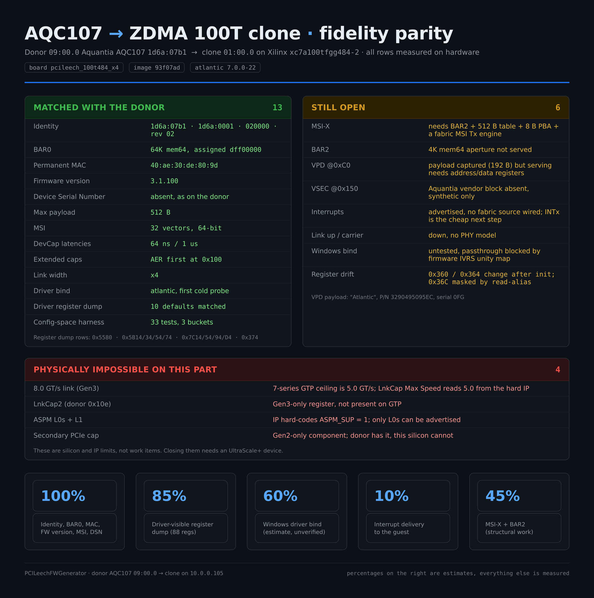

# Case study: cloning an Aquantia AQC107 onto a ZDMA 100T

A worked example of the whole pipeline, with the parity measured on real hardware
rather than estimated. The donor is an Aquantia AQC107 (`1d6a:07b1`, rev 02) in a
Linux host; the clone is an Artix-7 `xc7a100tfgg484-2` PCILeech ZDMA board
(`pcileech_100t484_x4`) sitting in a second machine's x16 slot.



## What matches the donor

Every row below was read back from the clone with `lspci`, `ethtool` and the
driver's own register dump — not inferred from the profile.

| Field | Value |
|---|---|
| Identity | `1d6a:07b1`, subsystem `1d6a:0001`, class `020000`, rev 02 |
| BAR0 | 64K, 64-bit memory, host-assigned |
| Permanent MAC | donor MAC, served from the modelled firmware memory |
| Firmware version | `3.1.100`, as reported by `ethtool -i` |
| Device Serial Number | absent, as on the donor |
| Max payload | 512 B |
| MSI | 32 vectors, 64-bit |
| DevCap acceptable latencies | 64 ns / 1 us |
| Extended capabilities | AER first, at `0x100` |
| Link width | x4 |
| Driver bind | stock `atlantic` binds on the first cold probe |

The register dump is worth calling out: the driver exposes a fixed table of 88
registers (`hw_atl_utils_hw_mac_regs` in `hw_atl_utils.c`), which makes
`ethtool -d` the cheapest fidelity check available. Comparing the donor's dump
against the clone's narrowed the differences to 13, of which 10 are hardware
defaults that are now served at reset.

## What is still open

| Item | Standing |
|---|---|
| MSI-X | needs a served BAR2 plus a 512 B table, an 8 B PBA and a fabric-generated memory write |
| BAR2 | the 4K aperture is not served |
| VPD | the donor payload is captured (192 B) but serving it needs address and data registers, not a static image |
| VSEC | the Aquantia vendor block is not synthesised |
| Interrupts | MSI is advertised and enabled by the host, but no fabric source raises a message |
| Link up | no PHY model, so carrier stays down |
| Register drift | `0x360`/`0x364` read one thing during probe and another after firmware init |

## What this silicon cannot do

These are limits of the 7-series GTP transceiver and the hard PCIe block, not
work items:

- **8.0 GT/s (Gen3)** — the GTP ceiling is 5.0 GT/s, and the Link Capabilities
  register is generated by the hard IP, so it cannot be shadowed.
- **LnkCap2** — a Gen3-era register; the donor reports `0x10e`, this part has no
  such field.
- **ASPM L0s + L1** — the IP hard-codes `ASPM_SUP = 1`, so only L0s can be
  advertised.
- **Secondary PCIe capability** — a Gen2-only component.

Closing any of those requires an UltraScale+ device rather than an Artix-7.

## Reproducing the checks

```bash
# identity and link
lspci -vv -s 01:00.0

# driver-visible registers, both sides
sudo ethtool -d enp9s0 > donor_regs.txt     # donor
sudo ethtool -d enp1s0 > clone_regs.txt     # clone

# firmware version, both sides
ethtool -i enp9s0
ethtool -i enp1s0
```

The reference dumps used for the comparison live alongside this study in the
project's `artifacts/aqc107-zdma100t/` directory, together with the raw
configuration-space captures for both devices.
